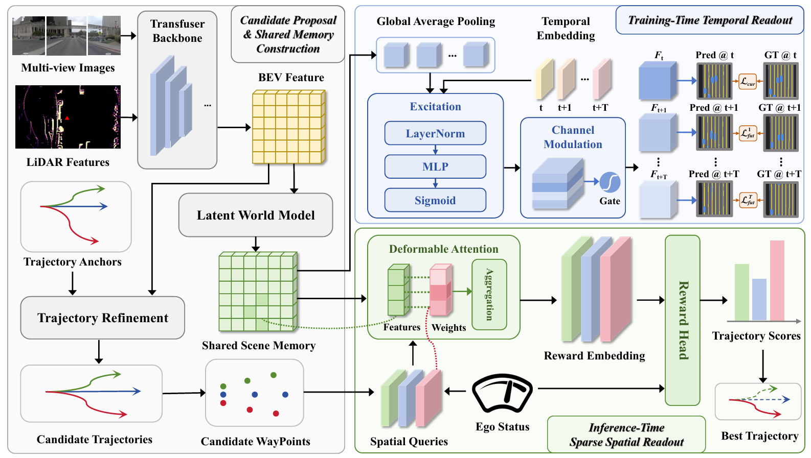

# RFWorld

**Trajectory Evaluation via Rollout-Free World Model for End-to-end Autonomous Driving**

Junzhe Wang, Jinqing Zhang, Qingjie Liu  
Beihang University  

[Code](https://github.com/Rupertail/RFWorld) · [Releases](https://github.com/Rupertail/RFWorld/releases)

RFWorld is a rollout-free world model for end-to-end trajectory evaluation. It builds a shared scene memory from camera, LiDAR, ego-state, and navigation inputs, shapes the memory with training-time temporal supervision, and scores candidate trajectories through sparse spatial readout.



## Results

On NAVSIM-v1, the released ResNet-34 model obtains **90.5 PDMS**. The reference evaluation covers the official 12,146-scenario test split.

## Repository and release assets

```text
rfworld_code/
├── navsim/       # RFWorld agent and the NAVSIM devkit components
├── scripts/      # training, metric caching, planning and evaluation entry points
├── download/     # official NAVSIM/OpenScene download helpers
└── assets/       # documentation assets
```

Download the three files from [GitHub Releases](https://github.com/Rupertail/RFWorld/releases) and place them at the following paths:

| Asset | Destination |
| --- | --- |
| `rfworld_tf_resnet34_pdms-905.ckpt` | `dataset/checkpoints/` |
| `resnet34.pth` | `dataset/checkpoints/` |
| `trajectory_anchors_1024.npy` | `dataset/planning/` |

## Installation

```bash
conda create -n rfworld python=3.9 -y
conda activate rfworld
python -m pip install -r requirements.txt
python -m pip install -e .
```

The scripts use the repository checkout, `dataset/`, and `exp/` by default. They use the active `python` executable and accept Hydra overrides. To place data or outputs elsewhere, set `RFWORLD_DATA_ROOT`, `RFWORLD_EXP_ROOT`, and optionally `PYTHON` before running a script.

## Quick start

Download and organize the official NAVSIM/OpenScene data with the helpers in `download/`. The expected layout and complete reproduction sequence are in [`docs/REPRODUCTION.md`](docs/REPRODUCTION.md).

Build the test metric cache and evaluate the released checkpoint:

```bash
bash scripts/evaluation/run_test_metric_caching.sh
bash scripts/evaluation/eval_rfworld.sh
```

For training, prepare the trainval metric cache and anchor PDMS targets, then run:

```bash
bash scripts/evaluation/run_train_metric_caching.sh
bash scripts/planning/gen_pdm_score.sh
bash scripts/training/run_rfworld.sh
```

The cache and target generation steps can be resumed; they require the full dataset and can consume substantial disk space. 

## Acknowledgements and license

This release builds on the [NAVSIM](https://github.com/autonomousvision/navsim) devkit and OpenScene data. Their licenses and access terms continue to apply. The repository is released under the Apache License 2.0; see [LICENSE](LICENSE).
